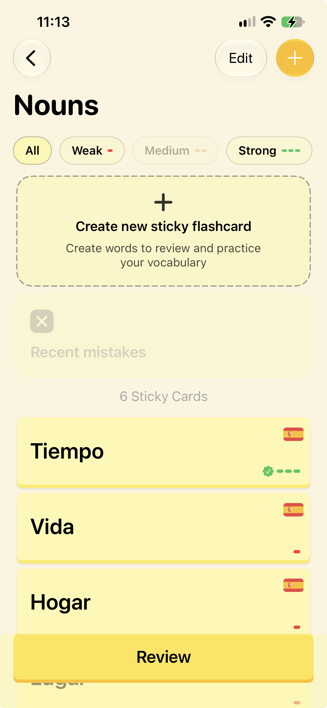

# Stickies

Stickies is an iOS app for learning vocabulary in a new language with sticky-note flashcards.

<p align="center">
  
</p>

## Features

- **Languages and decks**: add the languages you're learning and sort your flashcards into decks.
- **Sticky flashcards**: each card has a word or phrase, its translation, and an optional pronunciation and example phrase.
- **Study mode**: flip through your cards and mark each answer right or wrong.
- **Spaced repetition**: every card has a strength level that drops over time unless you practice it, so weak words come back first.
- **Recent mistakes**: review the cards you've been getting wrong.
- **Streak calendar**: see which days you studied.
- **iCloud sync**: your data syncs across devices with SwiftData and CloudKit.
- **Premium**: in-app purchases through StoreKit.

## Tech stack

- Swift and SwiftUI
- SwiftData (with CloudKit sync)
- StoreKit
- Built with Xcode 26; deployment target is iOS 18.0

## Project structure

```
Stickies/
├── App.swift / StickiesApp.swift   # App entry point, constants, theme colors
├── Models/                         # SwiftData models (Language, Deck, Sticky, StudyDay)
├── ViewModels/                     # Home, navigation, study mode, new card
├── Managers/                       # SRS, study tracking, purchases, paywall, reviews
├── Views/                          # SwiftUI screens and components
├── Extensions/                     # Calendar and Color helpers
└── Assets.xcassets                 # Colors, flags, mascot art, app icon
```

## Getting started

1. Clone the repo.
2. Open `Stickies.xcodeproj` in Xcode.
3. Select the `Stickies` scheme and an iPhone simulator.
4. Build and run (`⌘R`).

iCloud sync and in-app purchases need a signed build with the right capabilities set up on your Apple Developer account.
